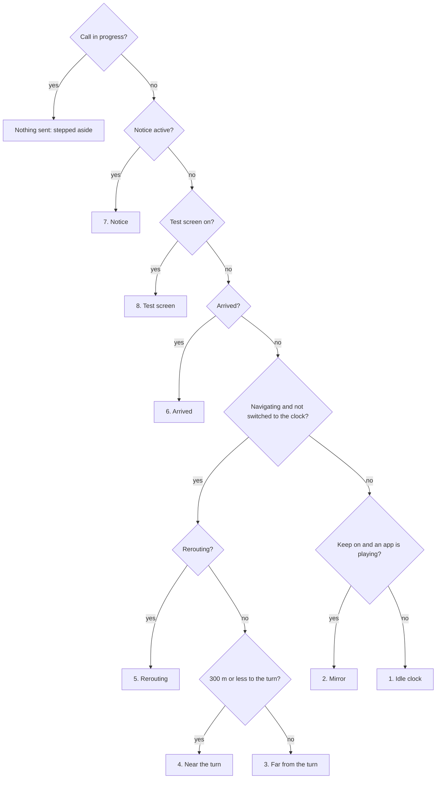
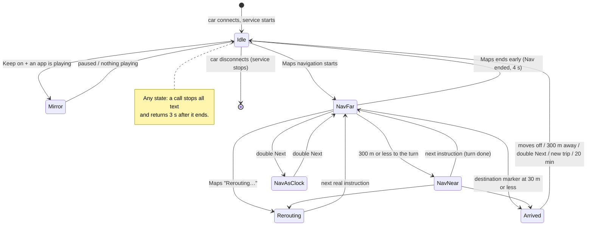

# Car screens

Every screen the app can put on the Honda. The car shows three text lines (plus its own track number at the top and the phone name at the bottom):

| Row | Android field | Icon on the car | Limit we use | What the car shows |
|---|---|---|---|---|
| **Line 1** (big) | title | none | 15 | 17 characters |
| **Line 2** | album | disc | 18 (20 for time / song lines) | 20 |
| **Line 3** | artist | person | 18 (20 for the song line) | 20 |

The row order (title, album, artist from top to bottom) was confirmed by the 11 Nov glyph test; older screens (clock, notices, Arrived) are placed by the same mapping.
TODO: add a photo of each screen to confirm every row.

In the mock-ups, `[ ]` marks a line that is empty. Fonts are proportional, so lengths are in characters, not columns.

## 1. Idle: clock and speed

Shown when not navigating (and Keep on screen is off, or nothing is playing).

```
L1  17:03 32 km/h          clock + GPS speed ("--" without a recent fix)
L2  Now Steering
L3  Thu 12 Nov
```
(The code writes two spaces after the clock; the engine collapses them.) With *Seconds on idle clock* (Diagnostics): `17:03:21 32km/h`.

## 2. Keep-on mirror (setting "Keep Now Steering on screen")

Shown instead of 1 while another app is **playing** (PLAYING or BUFFERING). Back to 1 when paused or nothing plays.

```
L1  17:03 32 km/h
L2  ▶ Falling
L3  2:31 left ███▒▒▒       or the artist for live streams (no length)
```
Browser tabs are never shown as a song. A title that is unreadable once unsupported characters are dropped is not shown. A missing title is held for 4 s between songs.

## 3. Navigation, far from the turn (more than 300 m)

```
L1  ← 750 m                arrow + distance to the turn (counts down, see DESIGN)
L2  12 min ███▒▒▒          Maps' time left + 6-cell trip bar
L3  ▶ Falling - Trevor     the playing song, cut at a word to 20; else the road: 13th Main Rd
```
- Arrow: `↑ ← → ↖ ↗` from Maps' icon; `●` when the destination is ahead; `•` for an icon not yet labelled.
- Setting *Arrival time on line 2*: L2 becomes `12 min · 19:42` (no bar).
- Setting *Trip bar* off: L2 is the time only. Song prefix (Diagnostics): `▶` (default), none, `•` or `♪` (♪ draws as a dot).

## 4. Navigation, near the turn (last 300 m)

Enters at 300 m, leaves above 340 m or on a new instruction.

```
L1  ← 230 m
L2  ← ██▒▒▒▒▒▒▒▒           arrow + 10-cell bar that fills as the turn approaches
L3  13th Main Rd           Maps' road text (the song is hidden here)
```
With the *Turn bar* setting off, L2 stays as in screen 3 but L3 still shows the road.

## 5. Rerouting

```
L1  • Rerouting...
L2  [ ]
L3  [ ]
```
Until Maps sends the next real instruction.

## 6. Arrived

```
L1  ● Arrived
L2  11:12                  clock time of arrival
L3  Work                   destination name
```
Appears when Maps shows its destination marker with ≤ 30 m left, or Maps ends navigation with ≤ 150 m left.
Stays until: the car stops and then exceeds 10 km/h, or the phone's location moves 300 m (works without GPS), or a new trip starts, or double Next, or 20 min, or the car disconnects.

## 7. Notices (timed overlays, highest priority)

| Screen | L1 | L2 | L3 | For | When |
|---|---|---|---|---|---|
| Power saving | `Power saving on` | `turn it off` | `nav less smooth` | 6 s | service start, navigation start, Power saving switched on |
| Navigation ended early | `Nav ended` | [ ] | [ ] | 4 s | Maps ends with more than 150 m left |
| No music app | `No music app` | [ ] | `Start music first` | 3 s | Next / Previous / Pause pressed with nothing to forward to |
| No notification access | `No music link` | `in Now Steering app` | `Grant notif access` | 3 s | same, but Notification access is off |

## 8. Test screens (Diagnostics only)

Shown until *Back to live*; limits 17 / 20 / 20; experimental glyphs let through.

| Button | L1 | L2 | L3 |
|---|---|---|---|
| ♪ glyph | `♪ ♫ • ▶ ♪` | `♪ Falling` | `♪ Falling - Trevor` |
| Glyph candidates | `♩ ♬ ♭ ♯ ♠` | `♣ ♥ ♦ ☼ ♀` | `♂ « » ○ ◊` |
| Song widths | `Song 20 chars` | `Falling - Trevor Dan` | `MWMWMWMWMWMWMWMWMWMW` |
| Line 2 text | `Line 2 text` | `1 hr 59 min 11:59pm` | `12 min · 19:42` |
| Bars | `Bars` | `12 min ███▒▒▒` | `1:02:31 left ██▒▒▒▒` |
| Mirror preview | `17:03 32 km/h` | `▶ Falling` | `2:31 left ███▒▒▒` |

## Priority: which screen wins



## How the screens change


*NavAsClock* = navigating, but the idle screen is shown on request.

## What the buttons do in each state

Buttons reach the app only while it holds the car (during navigation, after *Show on car*, with *Keep on screen*, or when the other app is paused).
Otherwise they go straight to the music app and do whatever that app does.

| State | Next ×1 | Next ×2 | Next ×3+ | Previous | Head-unit Pause |
|---|---|---|---|---|---|
| Idle / Mirror | next song (forwarded) | nothing (logged "staying on idle") | ignored | previous song (forwarded) | pause / resume the playing app |
| Nav (all) | next song | switch to the clock screen | ignored | previous song | pause / resume |
| Nav as clock | next song | back to the nav screen | ignored | previous song | pause / resume |
| Arrived | next song | clears Arrived (clock) | ignored | previous song | pause / resume |
| Test screen | next song | ignored | ignored | previous song | pause / resume |

Forwarded Next / Previous are dropped while the music app is loading, in ERROR, or within 2 s of a track change (see DESIGN). The first Previous restarts the current song and the second goes back one (that is the music app's behaviour).
Long presses never reach the app: the car beeps at about 2 s and keeps them.
