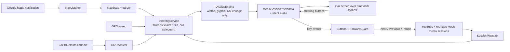

# Design

How Now Steering works and why. Source is in `nowsteering/src/main/java/com/nowsteering/app/`. Screens: [CAR_SCREENS.md](CAR_SCREENS.md). Reasons: [DECISIONS.md](DECISIONS.md).

## Overview

The car's stereo shows whatever "Now Playing" text the phone's Bluetooth stack reports. The app is a **media player that never plays music**:
it keeps an Android `MediaSession` active with a looping, inaudible audio track, and writes its own text into that session's title / album / artist.
Everything else (navigation, clock, song) is just choosing which three lines to write, at most once per second.

## The silent-audio media session, and why no audio focus

- `SteeringService` is a foreground service (types: media playback, and location when permitted). It owns one `MediaSession` and plays a one-second looping
  `AudioTrack` (±1 LSB, about −90 dB, inaudible), `USAGE_MEDIA`. It is restarted to "re-grab" the car (see Claim rules).
- **It never requests audio focus.** With focus, YouTube Music is paused the moment we start (seen in the probe); without it, music keeps playing and only the *text* is ours.
- **Which app the car follows** was checked in Android 13's source: `MediaSessionStack` sends media-button events to "the lastly played app", i.e. the app whose
  audio player most recently *started* and is still active, and the Bluetooth stack (`MediaPlayerList`) sets the car's active player from that same session.
  So the car's screen and the steering-wheel buttons always follow the same app. When YouTube starts a video it becomes that app; restarting our silent audio takes it back.
  A paused app does not hold it: if the other app pauses, our still-running silent audio is the newest active player and the buttons come back to us.
- Text updates are **metadata-only, in place** (same media id, same duration): the Honda refreshes on every change at 1 per second. Other refresh styles exist in Diagnostics
  for experiments (playback-position bump, fake track change) but the default is the one proven in the car.

## Display engine (`DisplayEngine`, `Glyphs`, `Screen`)

- A **screen** is three lines. Top to bottom on the car: line 1 = title (the big line), line 2 = album (disc icon), line 3 = artist (person icon). `Screen.lines(l1, l2, l3)` maps these.
- Limits: title 15 (the car shows 17), lines 18 (the car shows 20), song line 20. Longer text is cut at a word boundary when that keeps at least 60 % of the limit.
- Glyphs: ASCII, Latin-1, and the confirmed set `← → ↑ ↓ ↖ ↗ • ● ▲ ▶ ▼ █ ▓ ▒ ▄`. Anything else is replaced with an ASCII fallback or dropped (`⇐` → `<=`, emoji dropped).
  A title that is unreadable after that (Hindi, emoji only) falls back to the road on the nav screen.
- **Change-only, at most once per second**: the newest pending screen wins. Calls pause the engine; it resumes and re-sends afterwards.
- Diagnostics test screens bypass the narrower limits (17 / 20 / 20) and let experimental glyphs through so the car can be probed.

## Reading Google Maps (`NavListener`, `NavTextParser`, `IconSig`)

`NavListener` is a `NotificationListenerService` (the same access also lists other apps' media sessions). For Maps' navigation notification:

| Notification field | Meaning | Parsed as |
|---|---|---|
| title | distance to the next maneuver | `300 m`, `1.2 km` (feet / yards / miles are shown as Maps gives them but get no countdown or bars) |
| text | road, optionally `… towards X` or `A / B` | first road name; `to X` when only "towards X" |
| sub text | `7 min · 2.6 km · 07:04 ETA` | time left (Maps' own), distance left, arrival clock |
| large icon | the turn arrow (a picture only) | 24 × 24 mask compared with labelled icons in `KnownIcons`; unknown icons show `•` and are logged as ASCII art once |

Defensive rules, each from a real drive:
- Maps alternates the real instruction with a "heading" variant (empty or `0 m` title, `towards X` text). Once a real instruction exists, variants and blank / no-distance notifications are ignored ("held previous screen").
- `Starting navigation…` is not an instruction. `Rerouting...` is shown as `• Rerouting...` until the next real instruction.
- For the first 30 s of a route a *different* instruction must hold for 3 s before it is shown (Maps flips between "Head east" and the first street).
- Arrival: `●` (destination marker) with ≤ 30 m left is "arrived" at once; if Maps ends navigation with ≤ 150 m left that also counts.
- Raw fields are logged on every change (`[MAPS] raw …`) so the parser can be tuned from real drives.

## Distance to the turn: dead reckoning (`DeadReckoner`)

Maps updates every 1 to 3 s with the screen on but about every 20 s with the phone locked. The displayed distance follows these rules:
1. While Maps updates, show **Maps' value**.
2. After 2 s of Maps silence, count down with **GPS speed**.
3. When Maps comes back higher than what is shown: one blip under 30 m is ignored; higher twice in a row pauses our countdown until Maps catches up (it resumes after 3 s of silence); 30 m or more jumps to Maps.
4. After 90 s without any Maps update, **hold** the last shown value (it neither reverts nor guesses further).
5. The shown number is rounded **up** to Maps' own steps (10 m under 300 m, 50 m under 1 km, then 0.1 km), so the car never reads less than the estimate.

Result in the car (test 6, 2 Nov): the estimate stays 4 to 20 m above Maps and never below. The trip bar uses distance left against the largest distance left seen on the trip.

## Claim / re-claim rules (`SteeringService`)

"Claiming" = restarting our silent audio so we are the newest active player again (and therefore the car's screen and buttons are ours).

| Situation | What happens |
|---|---|
| Navigation starts, and at each new instruction | Re-grab (instructions at most every 10 s unless forced). |
| Navigating, and another app starts playing / changes song / a forwarded Next or Previous | Re-claim **1.5 s later** (lets the other app finish starting its player), a burst of events becoming one claim. |
| **Keep Now Steering on screen** on, not navigating | Same as above, but only if some other app is actually playing. |
| Keep off, not navigating | **No claim**: the other app's own song info stays on the car. |
| **Show on car** (notification button) | Claim at once. |
| Limits for automatic claims | At most 1 per 2 s and 4 per 30 s; after the limit, wait 10 s. Never during a call. |

`[CLAIM]` log lines say why each claim was made or skipped, with "last button to us … ago".

## Buttons and forwarding (`Buttons`, `ForwardGuard`)

- The Honda sends every press as an instant DOWN + UP (events have `eventTime=0`), never a hold, never PLAY (the head-unit button always sends PAUSE).
  Only **DOWN** starts an action; a lone UP (when the other app took the DOWN) does nothing.
- **Next** counts taps for 600 ms: 1 = next song, 2 = switch nav / clock (or clear "Arrived"), 3 or more = ignored. **Previous** and **Pause** act at once. Pause is a toggle (play if paused).
- Presses are **forwarded** to the playing music app (else the last one that played). Buttons only reach us while we hold the car; otherwise they go straight to the music app.
- **Forward guard:** Next / Previous are sent only if the app is PLAYING or PAUSED and at least 2 s have passed since its last track change or since it settled.
  If it is loading (`NONE`, `STOPPED`, `BUFFERING`, `CONNECTING`) or in `ERROR`, the press is **dropped** and logged (`[FWD] next DROPPED …`).
  Reason: forwarding a skip into a loading regular-YouTube player made it show "An error occurred". Dropped, not delayed: a missed press is harmless, a late skip is a wrong action.
- If there is nothing to forward to, the car shows a 3 s notice (`No music app` or `No music link`).

## Call safeguard (`CallGuard`)

The moment `AudioManager.mode` leaves `NORMAL` (ringing, in a call, VoIP) the app **steps aside completely**: silent audio stops, the session goes inactive, no text is sent.
It comes back 3 s after the mode is normal again. A mode listener plus a 1 s poll are used; no phone-state permission is needed. Every step is logged (`[CALL]`).
This exists because the probe once left the car on a call display; the cause was later traced to microphone use in another app, not to us.

## Power saving

Samsung Power saving switches location off while the screen is off, so GPS speed and dead reckoning stop on a locked phone. The app cannot work around that.
It checks `isPowerSaveMode`, lists it as a required item in the main-screen checklist, and shows `Power saving on / turn it off / nav less smooth`
on the car for 6 s (service start, navigation start, or when it is switched on). The log records the location power-save mode.

## Lifecycle and auto-start (`CarReceiver`)

The chosen car's Bluetooth connect (ACL or A2DP) starts the service; disconnect stops it. While running it holds a partial wake lock so the CPU keeps running with the screen off.

## Logging (`NsLog`, `KeyLines`, `LogFileProvider`)

- One timestamped text log in the app's files folder, trimmed to the newest ~1 MB when it reaches 2 MB, kept across restarts. Tags: `APP SERVICE SESSION SESSIONS CLAIM KEY GESTURE FWD CALL SCREEN MAPS NAV DR ICON GPS PHONE BT AUDIO UI NOTE PERM LISTENER`.
- Header with phone, Android, app version, permissions, car, display settings.
- **Share key lines** exports only buttons, gestures, forwards, claims, session changes, notes and mirror screens (repeats collapsed), **as a file**.
  **Share file** sends the whole log; **Share text** switches to a file above 60 000 characters. Text over about 100 KB cannot be shared as an intent extra (Android's call limit), which is why files are used. Any sharing failure shows a dialog.

## Torque Pro data (`TorqueClient`, `TorquePid`) — Phase 2b probe

- Reads Torque Pro through its plugin service (AIDL `org.prowl.torque.remote.ITorqueService`, copied unchanged into `src/main/aidl`; method order must not change). Bound by class name `org.prowl.torque.remote.TorqueService` in package `org.prowl.torque` (Lite: `org.prowl.torquefree`); `<queries>` in the manifest makes both visible on Android 11+.
- Bind flags are 0 (no auto-create): Now Steering never starts Torque. If Torque is off, it retries every 10 s and also on Torque's `APP_LAUNCHED` broadcast.
- Read-only calls only: getVersion, hasFullPermissions, isConnectedToECU, listAllPIDs / listActivePIDs / listECUSupportedPIDs (once per connection; Torque says they are expensive), getPIDInformation, getPIDValuesAsDouble, getPIDUpdateTime (1 s). Never used: sendCommandGetResponse, requestExclusiveLock, sendPIDData*, setPIDData, anything that writes.
- Polling runs on its own thread; values older than 10 s are shown as stale, never as numbers.
- TODO: confirm on the car that the service name binds, and which PIDs Torque exposes without being active on a dashboard.

## Source map

| File | Role |
|---|---|
| `SteeringService.kt` | screens, session, silent audio, claim rules, GPS, buttons wiring |
| `NavListener.kt` | Maps notification → `NavState`; Notification-access entry point |
| `NavText.kt`, `IconSig.kt` | parsing text and arrow icons |
| `DeadReckoner.kt`, `Bars.kt`, `Layouts.kt` | distance rules, bars, line layouts, turn zone |
| `DisplayEngine.kt`, `Glyphs.kt` | widths, glyph fallback, rate limit |
| `SessionWatcher.kt` | other apps' media sessions, song info, takeover events |
| `Buttons.kt`, `ForwardGuard.kt` | gestures and forwarding policy |
| `CallGuard.kt`, `CarReceiver.kt` | call safeguard, auto-start |
| `NsLog.kt`, `KeyLines.kt`, `LogFileProvider.kt` | logging and export |
| `MainActivity.kt`, `DiagnosticsActivity.kt`, `Presets.kt` | phone UI |
