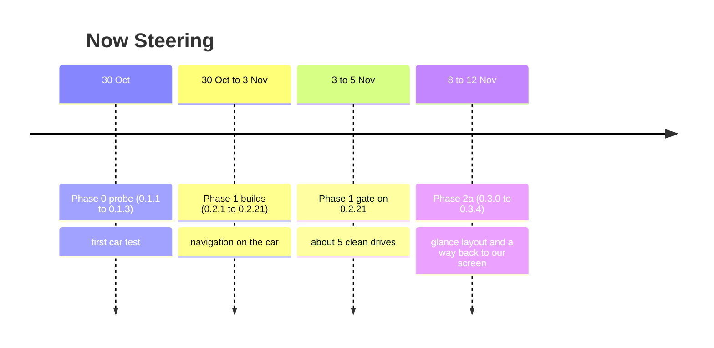

# History

Dates are release dates (UTC, from GitHub). Car and drive tests use the phone's local time (Bengaluru, IST). "Build N" releases were numbered by
the build counter; from v0.3.0 releases use version numbers. See [CHANGELOG.md](../CHANGELOG.md) for the short list.

## Phase 0: what can this stereo do? (probe app, 30 Oct)

A throw-away probe (`com.nowsteering.probe`) with a media session playing near-silent audio, a text tester, refresh experiments,
button logging, a media-session list and an event log with Share.

| Version | Date | What |
|---|---|---|
| 0.1.1-probe | 30 Oct | First probe: foreground MediaSession with silent audio; presets for characters, widths and refresh modes; auto counter; button and Bluetooth logging; event log with Share. |
| 0.1.2-probe | 30 Oct | PM addendum: DOWN and UP logged separately; live gesture readout (single / double / triple tap, long hold, adjustable timings); test steps per gesture. |
| 0.1.3-probe | 30 Oct | Fixes after the first car test: the car's key events have `eventTime=0`, so timing is measured on arrival; START warns if the session already runs. |

**First car test (30 Oct evening, 2014 Honda City, YouTube Music):** see [PHASE0_REPORT.md](PHASE0_REPORT.md). In short:
characters, widths (title 17, artist and album 20, no scrolling, 120 characters rejected) and in-place refresh at 1 s all measured;
Next / Previous detected as single, double and triple taps (never as holds); the head-unit button always sends PAUSE, never PLAY.
Coexistence was partial: our session could be the one the car shows while YouTube Music kept playing, but YouTube Music took the screen back at every song change.
After a phone call the car stayed on a call display (later traced to microphone use, see CAR_PROFILE). Session 2 of the probe was written but never run (dropped by the PM on 1 Nov).

## Phase 1: navigation on the car (30 Oct to 5 Nov)

The real app (`com.nowsteering.app`), same signing key as the probe, probe kept installable alongside.

| Version | Date | What changed | What the car test found |
|---|---|---|---|
| 0.2.1 (build-1) | 30 Oct | First app: display engine (widths, glyph fallback, 1 update/s), Google Maps notification parser, idle clock with GPS speed, button forwarding, call safeguard, auto-start, Settings and Diagnostics screens. | Not installed (version-code problem fixed in the next build). |
| 0.2.12 (build-2) | 30 Oct | Version codes keep rising after the CI counter reset. | Drive 1 (31 Oct): GPS speed and the call safeguard worked; **no navigation and no button forwarding because Notification access was never granted**; car not chosen; the car screen stopped updating when the phone locked. |
| 0.2.13 (build-3) | 31 Oct | Setup checklist on the main screen; wake lock while the car is connected; selectable refresh style; seconds on the idle clock; screen and A2DP logging. | Seconds kept ticking with the phone locked: the wake lock fixed the freeze. |
| 0.2.14 (build-4) | 31 Oct | Buttons: refresh the session list before forwarding; show on the car why a press did nothing. | Test 2 (1 Nov, drive of ~850 m): auto-start worked; Next / Previous / Pause forwarded to YouTube Music (the car showed "Now Steering" for ~1 s before YouTube Music took the screen back at the song change). Navigation showed `· 0 m` / ETA / `to 2nd Cross Rd`. With the phone locked Maps' notification came only about every 20 s (once a 60 s gap) against 1 to 5 s with the screen on, so the distance counted down too slowly. Two alternating Maps variants flickered the lines; long names were cut mid-word; the switch to the clock after arrival felt like something had stopped. |
| 0.2.15 (build-5) | 1 Nov | Six Maps arrow icons labelled from the logs; first dead reckoning (count the distance down with GPS speed between Maps updates); Arrived screen for 10 s; first name of "A / B" roads. | Fixes for the 0.2.14 drive; not separately tested. |
| 0.2.16 (build-6) | 1 Nov | Ignore Maps' "towards X" variant once a real instruction shows; cut long names at a word. | Test 3 (1 Nov): real arrows correct at every turn; countdown smooth (Maps updated every 1 to 3 s even locked, Power saving off; our estimate's median error 2 m); `● Arrived` for 10 s was easy to miss. |
| 0.2.17 (build-7) | 1 Nov | Arrived stays until the car moves (> 10 km/h), a new trip, double Next or disconnect; "Starting navigation…" no longer counts as an instruction; destination pin icon labelled; Power saving only advisory. | |
| 0.2.18 (build-8) | 1 Nov | Turn bar (last 300 m) and trip bar; re-claim the car after a song change while navigating; ignore upward distance corrections under 30 m. | 2 Nov: bars fit; song-change re-claim worked. Found: our estimate ran 16 to 25 m **ahead** of Maps and showed `0 m` while Maps said 20 m; "Arrived" came 55 s late; with Power saving on there were no GPS fixes with the screen off. |
| 0.2.19 (build-9) | 2 Nov | Dead reckoning rewritten (follow Maps, count only in gaps, pause when Maps stays higher); hold the previous screen over blank / no-distance notifications; Arrived at the destination marker (≤ 30 m) and cleared without GPS; start-up debounce; Power saving warning on the car (required again); turn bar starts with its arrow. | Test 6 passed: warning, clean start, turn bar, Arrived on the marker, cleared at 11 km/h; estimate stayed 4 to 20 m above Maps, never below. |
| 0.2.20 (build-10) | 2 Nov | `• Rerouting...` during a real reroute. | |
| 0.2.21 (build-11) | 2 Nov | Displayed distances round **up** to Maps' steps, so the car never reads below the estimate. | Phase 1 gate (3 to 5 Nov): about 5 clean drives, no wrong or stuck prompts; gate closed 5 Nov. |

## Phase 2a: glance layout and a way back (8 to 12 Nov)

Problem from the gate: with the regular YouTube app playing and no navigation, YouTube keeps the car screen and there was no way back.

| Version | Date | What changed | What the car test found |
|---|---|---|---|
| 0.3.0 | 8 Nov | Releases named by version. Nav far from a turn: line 2 = time left + trip bar, line 3 = the song. Last 300 m: turn bar + road. Notification button **Show on car**; setting **Keep Now Steering on screen** (mirror of the playing title); triple-tap Next; one-tap car test screens; Share key lines. | 11 Nov parked test passed: widths, bars, Show on car, Keep on screen with the regular YouTube app. ♪ shows as a dot. Drive 1 (nav) passed. Drive 2 leg A (Keep off) confirmed that with Keep off the wheel buttons go straight to YouTube (no `[KEY]` line), and found a bug: a skip forwarded to YouTube while it was loading made it show "An error occurred". |
| 0.3.1 | 11 Nov | Next / Previous are dropped (not forwarded) while the app is loading, settling (< 2 s after a track change) or in ERROR. Triple-tap removed. | Fix check passed: second press of a quick pair was dropped three times, no YouTube error. |
| 0.3.2 | 11 Nov | ▶ added as the song prefix and made the default; "Glyph candidates" test screen. | Glyph test: ♩ ♬ ♭ ♯ ♠ ♣ ♥ ♦ ☼ ◊ ♪ ♫ draw as dots; ♀ ♂ « » ○ ▶ draw. Leg B (Keep on) passed. |
| 0.3.3 | 11 Nov | Diagnostics layout: normal dropdown layout, full-width tester fields, song prefix as a radio list. | Final check: Next while navigating works; Previous: first press restarts the song, second goes back one. |
| 0.3.4 | 12 Nov | **Share key lines** sent as a file, with an error dialog if sharing fails. | The text export did nothing at ~750 KB (Android's share limit). |
| 0.4.0 | 12 Nov | Phase 2b probe: read-only Torque section in Diagnostics, `[TORQUE]` log lines. Car screen unchanged. | Probe passed (3 drives, 345 snapshots): bind works, API 38; coolant PID 05, voltage PID 42, Trip KPL confirmed; fuel remaining unreliable (2.75 % at 72 km); Home Assistant kept updating. Bug: Diagnostics showed "87 of 0 known" (count overwritten). |
| 0.5.0 | 13 Nov | v2 foundation: fields, rules, faces, warning layer, car profile; no visible change. C.2 (car data on screen) paused for the redesign. | TODO: regression drive. |

## Phase 2b: car data from Torque Pro (started 12 Nov)

0.4.0 is the probe (Diagnostics only). See [PHASE2B_PROBE_SCRIPT.md](PHASE2B_PROBE_SCRIPT.md). Result (12 Nov, PASSED): bind works, API 38; OBD connect/disconnect tracked across 3 drives (17:25–17:34, 17:46–17:56, 19:38–19:49) with 345 value snapshots, also with Diagnostics closed; 202 PIDs known, 86 ECU-supported, 62 active; Home Assistant kept updating. Values for the car screen: coolant PID 05, voltage PID 42 (not the adapter's Volts(Ad)), trip average KPL ff1206, fuel used (trip) ff1271. Fuel remaining (2.75 % at 72 km) and distance to empty (ff126a) are unreliable on this car: never shown. C.2 was then paused for the v2 redesign.

## Open items

- TODO: the first Phase 1 build (0.2.1) was never installed; confirm it was never used.
- Phase 1 gate: about 5 normal drives on 3–5 Nov 2026 on v0.2.21, closed 5 Nov; exact per-drive dates were not recorded.
- TODO: AVRCP version of the head unit (assumed old: no album art).
- TODO: the build that each early Phase 1 observation belongs to comes from session notes; re-check against the saved logs if exactness matters.
